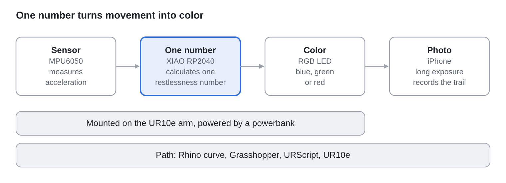
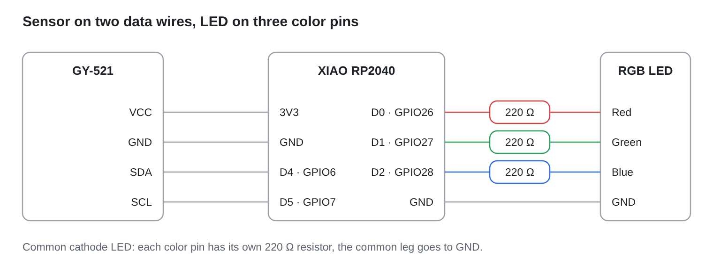

# Rested / Restless

A robot arm writes a word in light. The color of the light shows how restless the movement is:
**blue = calm, green = in between, red = wild**.

| RESTED | RESTLESS |
| --- | --- |
|  |  |

Course project, Creative Coding (MADFM), Hochschule Pforzheim, 2026. Paulina Bulanda.

## Idea

A small motion sensor sits on a UR10e robot arm together with an RGB LED. The arm writes
the word RESTED with a calm movement and the word RESTLESS with a restless movement. A
long-exposure photo records the light trail, so you can see the difference.

## How it works

1. The sensor (MPU6050) measures acceleration.
2. The board (XIAO RP2040) turns it into one number for restlessness.
3. The number decides the LED color.
4. A long-exposure photo records the light.

At rest the sensor reads about 1 g (gravity). The code takes the distance from this value
and smooths it, so the LED does not flicker.

| Restlessness number | LED color |
| --- | --- |
| below 0.08 | blue (calm) |
| 0.08 to 0.17 | green (in between) |
| above 0.17 | red (wild) |

## What you need

- Seeed XIAO RP2040
- GY-521 motion sensor (MPU6050)
- RGB LED (common cathode) and three 220 ohm resistors
- USB cable and a laptop to power the board
- UR10e robot arm with Rhino and Grasshopper
- Phone with a long-exposure camera app (I used Slow Shutter)

Wiring:

| Part | Connected to |
| --- | --- |
| Sensor SDA | D4 |
| Sensor SCL | D5 |
| Sensor VCC and GND | 3V3 and GND |
| LED red (with resistor) | D0 |
| LED green (with resistor) | D1 |
| LED blue (with resistor) | D2 |
| LED common leg | GND |

| Breadboard setup | On the robot arm |
| --- | --- |
|  |  |

## Files

| Folder or file | What is in it |
| --- | --- |
| `code/main.py` | The final program for the board |
| `code/steps/` | The first test scripts (02 to 05) |
| `code/library/` | The sensor driver (not written by me) |
| `robot/` | Rhino files, Grasshopper files, robot scripts |
| `diagrams/` | Diagrams |
| `media/` | Photos and videos |
| `documents/` | Project documentation and presentation slides (PDF) |

## How to run it

1. Wire the board as shown above.
2. Install MicroPython on the XIAO and open it in Thonny.
3. Copy `imu.py` and `vector3d.py` from `code/library/` onto the board.
4. Test step by step in Thonny: `02_imu_read.py` (sensor values), `03_restlessness.py`
   (the number) and `05_led_color.py` (the LED). `04_read_serial.py` reads the number on
   the laptop. Close Thonny before you run it.
5. Save `code/main.py` on the board as `main.py`. It starts when the board gets power.
6. Fix the board and LED on the robot arm. The board gets power over USB from the laptop.
   A powerbank only lit the LED for a few seconds.
7. Robot: draw the word in Rhino, open the Grasshopper file, copy the code from the CODE
   panel and save it as a `.script` file. Load it from a USB stick on the robot's
   teach pendant.
8. Photo: use Slow Shutter in *Light Trail* mode (light sensitivity 1/4, shutter speed
   Bulb, ISO 100) in a completely dark room. Start the photo, then start the robot.

If the robot does not run the program, check that the blend radius is smaller than the
distance between two points and that the whole word fits into the arm's reach.

## First tries

The first tries were taken in a bright room. The room light washes out the light trail,
so the final photos were taken in a completely dark room.

| RESTED, first try | RESTLESS, first try | Photo app settings |
| --- | --- | --- |
|  |  |  |

## Videos

- [First measurement with the sensor](media/first_measuring.mp4)
- [Rest value set to zero, number smoothed](media/zeroed_and_smoothed.mp4)
- [Robot arm writing RESTED](media/rested_robot_writing.mp4)
- [Robot arm writing RESTLESS](media/restless_robot_writing.mp4)

## What I learned

1. A library saves a lot of time.
2. An accelerometer measures acceleration, not speed.
3. Raw sensor values jump a lot, so I smoothed the number.
4. Testing in small steps makes it easy to find mistakes.
5. Code on the board runs without the laptop, but the board still needs power.
6. A robot path has limits: reach, point spacing and blend radius.

## Sources

- SunFounder Newton Lab Kit, section 6.3 (MPU6050 example)
- Peter Hinch and Shaun Plamauer, sensor driver (MIT license):
  https://github.com/micropython-IMU/micropython-mpu9x50
- pySerial documentation
- LED code from the course material
